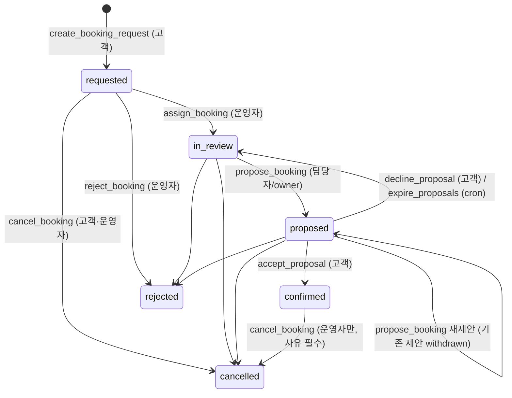
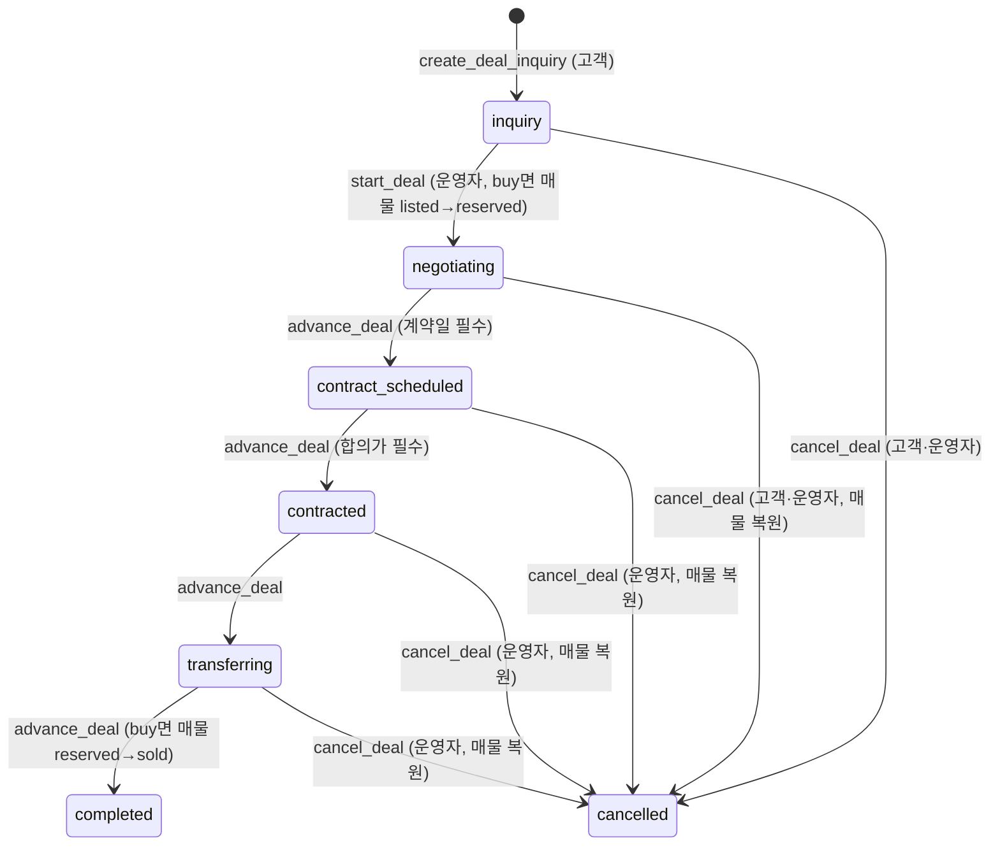

# 상태 머신

DB 함수와 1:1로 대응한다. 이 표에 없는 전이는 함수가 `GB409 invalid_state`로 거부한다.
변경하면 마이그레이션, pgTAP(003/004), `lib/domain/*/status.ts`(M3~)를 함께 바꾼다.

## 부킹 요청 `booking_status`

| 함수 | 호출자 | 허용 상태 | 결과 | 검증 |
|---|---|---|---|---|
| `create_booking_request` | 온보딩 완료 고객 | — | requested | 멱등키, rate limit, 날짜 오늘~180일, 활성 골프장 |
| `assign_booking` | 운영자(aal2) | requested, in_review, proposed | requested면 in_review, 나머지는 상태 유지 | 배정 대상이 운영자, version |
| `propose_booking` | 담당자 또는 owner | in_review, proposed | proposed | 미래 티타임, 유효시간 30~1440분, 기존 offered → withdrawn |
| `accept_proposal` | 요청 본인 | proposed + 제안 offered | confirmed | 멱등키, `expires_at > now()`, version |
| `decline_proposal` | 요청 본인 | proposed + 제안 offered | in_review | version |
| `reject_booking` | 운영자 | requested, in_review, proposed | rejected | 사유 필수 |
| `cancel_booking` | 본인 / 운영자 | 본인: requested~proposed, 운영자: +confirmed | cancelled | 운영자는 사유 필수 |
| `app.expire_proposals` | pg_cron(1분) | proposed + 만료 제안 | in_review | SKIP LOCKED |
| `app.mark_sla_breaches` | pg_cron(1분) | requested & 미응답 & 기한 경과 | 상태 유지, `sla_breached_at` | version 변경 없음 |

## 제안 `proposal_status`

`offered` → `accepted` | `declined` | `expired` | `withdrawn`(재제안·거절·취소 시). 요청당 offered 1건, accepted 1건(partial unique index).

## 회원권 거래 `deal_status`

| 함수 | 호출자 | 허용 상태 | 비고 |
|---|---|---|---|
| `create_deal_inquiry` | 온보딩 완료 고객 | — | buy는 listed 매물만, 같은 매물 진행 중 상담 1건, 멱등키, rate limit |
| `start_deal` | 운영자 | inquiry | buy: `UPDATE ... WHERE status='listed'` 0행이면 `listing_unavailable`. 담당자 미지정이면 호출자 |
| `update_deal_terms` | 담당자/owner | negotiating~transferring | 합의가·계약일, 상태 유지, version+1 |
| `advance_deal` | 담당자/owner | 한 칸 앞으로만 | 건너뛰기·후진 불가 |
| `cancel_deal` | 본인(inquiry·negotiating) / 운영자(사유 필수) | completed·cancelled 제외 | 점유 중 매물은 같은 트랜잭션에서 listed 복원 |

## 매물 `listing_status`

| 전이 | 경로 |
|---|---|
| hidden ↔ listed | `set_listing_visibility` (운영자) |
| listed → reserved | `start_deal` |
| reserved → listed | `cancel_deal` |
| reserved → sold | `advance_deal(completed)` |

## 공통 규칙

- 모든 전이: 대상 행 `FOR UPDATE` → version 일치 → 상태 검증 → version+1 → `*_events`(고객 타임라인) → `audit_logs` → `notification_outbox`
- 잠금 순서: 요청→제안, 거래→매물
- 남의 데이터는 존재 여부도 노출하지 않는다(`GB404 not_found`)

## 골프 모임 (M7)

### 모임 `group_status`
| 전이 | 함수 | 조건 |
|---|---|---|
| ∅ → active / review | `create_group` | 이름·소개에 금칙어가 있으면 review(D-68) + 운영자 알림 |
| active → review | `update_group` | 수정으로 금칙어가 생기면 |
| review·active ↔ hidden | `moderate_group`(운영자) | hidden이면 모임장 알림 |
| active·review → hidden | `report_content` | 같은 모임에 열린 신고 3건(D-69) |
| * → closed | `leave_group` | 마지막 멤버(모임장)가 떠나면(D-71) |

### 멤버 `group_member_status`
| 전이 | 함수 | 권한 |
|---|---|---|
| ∅ → active | `join_group` (공개 모임) | 본인, 정원 미만 |
| ∅ → pending | `join_group` (승인제) | 본인 |
| pending → active / 삭제 | `decide_join` | 모임장·운영진, 승인 시 정원 확인 + 알림 |
| active·pending → 삭제 | `leave_group` | 본인. 모임장이면 승계(D-71), 예정 정모 참석도 취소 |
| active·pending → banned | `kick_member` | 모임장(운영진까지)·운영진(멤버만). 재가입 불가 |
| banned → 삭제 | `unban_member` | 모임장 |
| 역할 member ↔ manager, 위임 | `set_member_role` | 모임장 |

### 정모 `meeting_status`
| 전이 | 함수 | 조건 |
|---|---|---|
| ∅ → scheduled | `create_meeting` | 모임장·운영진, 180일 이내 미래, 골프장 또는 장소 중 하나, 개설자 자동 참석, 멤버 알림 |
| 참석/취소 | `attend_meeting` / `cancel_attendance` | 활성 멤버, 시작 전, 정원(행 잠금) |
| scheduled → cancelled | `cancel_meeting` | 모임장·운영진, 참석자 알림 |
